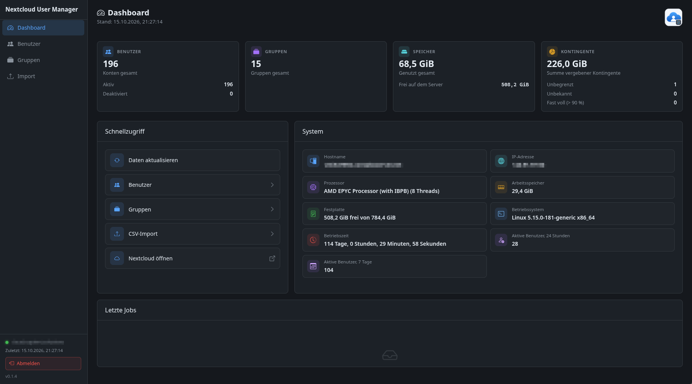

# Nextcloud User Manager



Desktop-App für Admins, die Nextcloud-User, -Gruppen und -Kontingente verwalten, vor allem in großen Mengen (z. B. Schuljahreswechsel). Die App spricht über die OCS Provisioning API mit dem Server. Sie zeigt ein Dashboard mit Kennzahlen und Systeminfos und eine durchsuch- und filterbare Userliste. Batch-Aktionen (löschen, (de)aktivieren, Gruppen, Kontingent) laufen immer mit Vorschau, Fortschritt und exportierbarem Ergebnisbericht. Neue User lassen sich per CSV (`Vorname;Nachname;Passwort`) importieren; die Usernamen werden dabei eindeutig nach den Regeln des Microsoft365-Managers erzeugt.

## Technologien

Electron, Vue 3 und Vite, Bootstrap 5 (nur CSS) mit bootstrap-icons, SweetAlert2 für Dialoge, Vitest und ESLint. Alle Netzwerkzugriffe laufen im Main-Prozess. Das App-Passwort wird mit Electron `safeStorage` verschlüsselt gespeichert.

## Starten

```bash
npm install
npm run dev     # Entwicklung
npm test        # Tests
npm run build   # AppImage in release/
```
